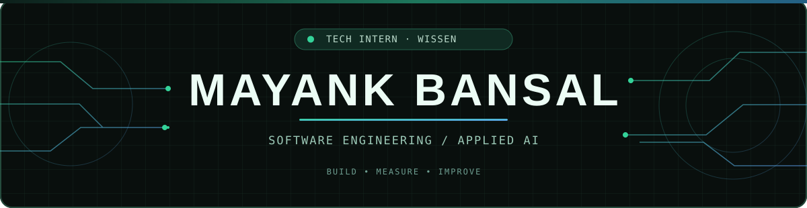

<div align="center">



<br />

**Tech Intern at Wissen Technology** · Computer Science student at Lovely Professional University

I build software, engineer AI systems, and turn ideas into working products.

[](https://www.linkedin.com/in/mayank-bansal14/)
[](https://mayank149.github.io/Portfolio/)
[](mailto:bansalmayank1414@gmail.com)
[](https://www.kaggle.com/mayankbansal2205/datasets)

</div>

---

## 01 / THE DEVELOPER

<table><tr><td width="60%" valign="top">

### A little about me

I'm a third-year Computer Science and Engineering student at **Lovely Professional University**, currently working as a **Tech Intern at Wissen Technology**.

My interests sit at the intersection of **software engineering and applied AI**. I build backend services, machine learning applications, RAG pipelines, and agentic systems, with an emphasis on measurable results and usable products.

</td><td width="40%" valign="top">

```python
class Developer:
    name = "Mayank Bansal"
    role = "Tech Intern @ Wissen"
    focus = ["Backend", "Applied AI", "RAG", "Agents"]
    approach = "Build. Measure. Improve."
```

</td></tr></table>

## 02 / THE TOOLKIT

<table><tr><td width="50%" valign="top">

**LANGUAGES**


SQL

**AI / MACHINE LEARNING**


Pandas · NumPy · NLP · Computer Vision

</td><td width="50%" valign="top">

**BACKEND / INFRASTRUCTURE**


**LLM / AGENT ENGINEERING**

LangChain · LangGraph · RAG · FAISS · ChromaDB · Ollama · Sentence Transformers

</td></tr></table>

---

## 03 / SELECTED ENGINEERING WORK

<table><tr><td width="50%" valign="top">

### [AI Career Copilot](https://github.com/Mayank149/AI-Career-Copilot-Complete-)

`FastAPI` `LangGraph` `RAG` `ChromaDB`

Agentic career assistant for job-fit analysis, skill gaps, and resume tailoring with human review.

**90% Recall@4 · 0.83 MRR@4**

</td><td width="50%" valign="top">

### [Technical Debug Assistant](https://github.com/Mayank149/Technical-Debug-Assistant)

`FastAPI` `FAISS` `Sentence Transformers`

Multi-hop technical QA with uploadable knowledge, persistent retrieval, and source attribution.

**93% RAG accuracy · ~800ms latency**

</td></tr><tr><td valign="top">

### [Visual Search Engine](https://github.com/Mayank149/Visual-Search-Engine)

`PyTorch` `ResNet50` `FAISS`

Reverse image search using 2048-dimensional visual embeddings and nearest-neighbour retrieval.

**~150ms retrieval latency**

</td><td valign="top">

### [AI Complaint Triage](https://github.com/Mayank149/AI-Complaint-Triage-and-Routing-System-with-Hybrid-Credibility-Scoring-and-Feedback-Learning)

`Scikit-learn` `Flask` `SQLite`

Explainable classification and routing across eight departments using hybrid rules and ML.

**8 departments · 800 synthetic records**

</td></tr></table>

---

## 04 / OPEN DATA & KAGGLE

I publish datasets for practical ML experiments and reproducible projects.

<table><tr><td width="50%" valign="top">

**[Multi-Class Waste Image Classification](https://www.kaggle.com/mayankbansal2205/datasets)**

Computer vision dataset for image classification experiments.

</td><td width="50%" valign="top">

**Complaint Triage Dataset**

800 synthetic examples across eight departments, built for multi-class routing experiments.

</td></tr></table>

[](https://www.kaggle.com/mayankbansal2205/datasets)

---

## 05 / MILESTONES

<table><tr>
<td align="center" width="25%"><h2>580+</h2><sub>GFG PROBLEMS</sub></td>
<td align="center" width="25%"><h2>180+</h2><sub>LEETCODE PROBLEMS</sub></td>
<td align="center" width="25%"><h2>101</h2><sub>DAY GFG STREAK</sub></td>
<td align="center" width="25%"><h2>159</h2><sub>GFG COLLEGE RANK</sub></td>
</tr></table>

<sub>GeeksforGeeks rank 159 is within my college leaderboard, not an overall platform rank.</sub>

**Published author:** [*Machine Learning Projects: A Practical Guide for B.Tech CSE Students*](https://www.amazon.com/dp/B0GX34T5HF)

**Published researcher:** [*Mood2Mail: A Lightweight Real-Time Email Tone Analyzer Using Classical ML*](https://zenodo.org/records/16102315)

---

## 06 / GITHUB ACTIVITY

<div align="center">


</div>

---

## 07 / CURRENTLY EXPLORING

**Agentic AI** · LangGraph orchestration and reliable tool use

**Systems Engineering** · Backend architecture, distributed systems, scalability

**Production AI** · RAG evaluation, reliability, MLOps

<details>
<summary><b>Engineering philosophy</b></summary>

I prefer building practical systems, measuring performance, understanding failure modes, and iterating until the result is useful beyond a demo.

</details>

---

<div align="center">

**BUILD · MEASURE · IMPROVE**

[Portfolio](https://mayank149.github.io/Portfolio/) · [LinkedIn](https://www.linkedin.com/in/mayank-bansal14/) · [Kaggle](https://www.kaggle.com/mayankbansal2205/datasets)

</div>
